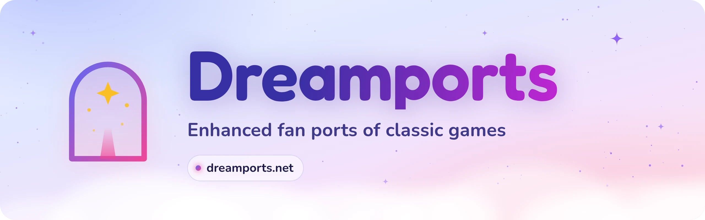

<picture>
  <source media="(prefers-color-scheme: dark)" srcset=".github/readme/banner-dark.webp">
  
</picture>

 

### Classic games, brought back by fans, with the extras fans dream of.

Free · Bring your own copy of the game · Coming soon to **dreamports.net**

 

[What is it?](#what-is-dreamports) &nbsp;·&nbsp; [What's inside](#whats-inside) &nbsp;·&nbsp; [Bring your own game](#the-golden-rule-bring-your-own-game) &nbsp;·&nbsp; [Progress](#progress) &nbsp;·&nbsp; [Help out](#help-out) &nbsp;·&nbsp; [Questions](#questions)

 

## What is Dreamports?

Dreamports is a website, coming soon at **dreamports.net**, that gathers fan-made ports of classic games in one place. This repository holds its source code.

A **port** is a game brought somewhere new to play: your web browser, your computer, or a newer console. A **Dreamport** is a port with the extras fans dream of, like widescreen, smoother motion or new ways to play, each one optional. The *dream* stands for *fan*: every Dreamport is made by a fan, for fans.

<table>
<tr>
<td width="33%" valign="top">

🌙 **Dreamports** 
Enhanced ports, each named after the game it brings back, such as *Sonic Advance Dreamport*.

</td>
<td width="33%" valign="top">

🧭 **External ports** 
Great ports made by other fans, with a link to their own page and full credit to the people who made them.

</td>
<td width="33%" valign="top">

✨ **Other games** 
Fan games that aren't ports, such as *Kirby's Dead Land*.

</td>
</tr>
</table>

## What's inside

These are the projects the site will start with. Each one lives in its own repository.

| | Project | What it is | Try it |
| :---: | :--- | :--- | :--- |
| 🌙 | **[Sonic Advance Dreamport](https://github.com/NahuelGenchi/sonic-advance-dreamport)** | Sonic Advance (Game Boy Advance, 2001), rebuilt to play in your web browser. No emulator, nothing to install. | [Play in your browser](https://nahuelgenchi.github.io/sonic-advance-dreamport/) |
| ✨ | **[Kirby's Dead Land](https://github.com/NahuelGenchi/kirbys-dead-land)** | A mod that lets you play as Kirby inside Dead Cells, with his moves and copy abilities. For Linux; Windows is in testing. | [Download](https://github.com/NahuelGenchi/kirbys-dead-land/releases/latest) |
| 🧭 | **Your favorite fan port?** | External ports are on their way. Know a great one? | [Suggest it](https://github.com/NahuelGenchi/dreamports/issues/new?template=work-item.yml) |

## The golden rule: bring your own game

> [!IMPORTANT]
> **Dreamports never hosts game files.** No ROMs, no game data, and nothing taken from a game, ever. Every project on the site asks you to use **your own legal copy** of the original game.

Not sure what that means? Here's how it works:

1. **You own the game,** on a cartridge or disc.
2. **You make your own copy** of it on your computer, called a *ROM* or a *game dump*. Each project explains which copy it needs.
3. **The port reads your copy on your device.** Your copy is never uploaded anywhere.

Before you play or download anything, the site will ask you to confirm that you're using your own legal copy.

## Progress

The work is split into four steps, called *milestones*. The bars update by themselves as work gets done.

| Step | What it means | Progress |
| :--- | :--- | :--- |
| **[M0 — Project foundation](https://github.com/NahuelGenchi/dreamports/milestone/1)** | This repository: its look, its rules and how work is tracked |  |
| **[M1 — First version of the site](https://github.com/NahuelGenchi/dreamports/milestone/2)** | The website itself: the home page, every section, and the about page |  |
| **[M2 — Live on dreamports.net](https://github.com/NahuelGenchi/dreamports/milestone/3)** | The site online at its own address, updated automatically |  |
| **[M3 — Growth](https://github.com/NahuelGenchi/dreamports/milestone/4)** | More entries, plus search, filters and news |  |

✅ The address **dreamports.net** is registered and waiting for the site.

## Help out

**No coding needed.** All you need is a free GitHub account.

<table>
<tr>
<td width="33%" valign="top">

💡 **Suggest a port** 
Know a great fan port that asks players to bring their own game? [Tell us about it](https://github.com/NahuelGenchi/dreamports/issues/new?template=work-item.yml).

</td>
<td width="33%" valign="top">

🐞 **Report a problem** 
A broken link, a typo, a page that looks wrong on your phone? [Let us know](https://github.com/NahuelGenchi/dreamports/issues/new?template=work-item.yml).

</td>
<td width="33%" valign="top">

⭐ **Follow along** 
Press **Star** at the top of this page to keep Dreamports on your radar.

</td>
</tr>
</table>

**Developers:** every change follows the same trail, 📝 issue → 🌿 branch → 🎯 milestone → 🔀 pull request, so anything on the site can be traced back to why it was made. Start with [CONTRIBUTING.md](CONTRIBUTING.md); the full rules are in [docs/TRACKING.md](docs/TRACKING.md).

## Questions

<b>Is Dreamports free?</b>

 

Yes. The site and every Dreamport are free.

<b>Where do I get the games?</b>

 

From cartridges or discs you own. You copy the game to your computer with a reader or a dumping tool, and each project's page explains which copy it needs. Dreamports can't give you games or tell you where to download them.

<b>Is this legal?</b>

 

Dreamports never hosts game files, and it only lists projects that ask you to use your own copy. Game names and trademarks belong to their owners. Dreamports is an unofficial fan project, not affiliated with or endorsed by Sega, Nintendo, or any other publisher.

The rules about copying games you own differ from country to country, so check the ones where you live. This isn't legal advice.

<b>Why "Dream"?</b>

 

*Dream* stands for *fan*. A Dreamport is the version of a game that fans dream of, made by a fan.

<b>Can my port be listed?</b>

 

Yes, if it asks players to bring their own legal copy and doesn't include game files. [Suggest it here](https://github.com/NahuelGenchi/dreamports/issues/new?template=work-item.yml), with a link to its page and who made it.

<b>When will the website be online?</b>

 

The site is being built now. Follow the [progress](#progress) above: it goes live with milestone M2.

<b>I found a security problem. Where do I report it?</b>

 

Privately, please, through the **Security** tab. [SECURITY.md](SECURITY.md) explains how.

## License and credits

The code is free and open source under the [MIT License](LICENSE).

The banner is original artwork made for Dreamports. It uses the [Fredoka](https://fonts.google.com/specimen/Fredoka) and [Nunito](https://fonts.google.com/specimen/Nunito) fonts, both under the SIL Open Font License. Its source, [`.github/readme/banner.html`](.github/readme/banner.html), can redraw it.

Game names and trademarks belong to their owners. Dreamports is not affiliated with or endorsed by Sega, Nintendo, or any other publisher.

 

Made by a fan, for fans · <a href="https://github.com/NahuelGenchi">Nahuel Genchi</a>

