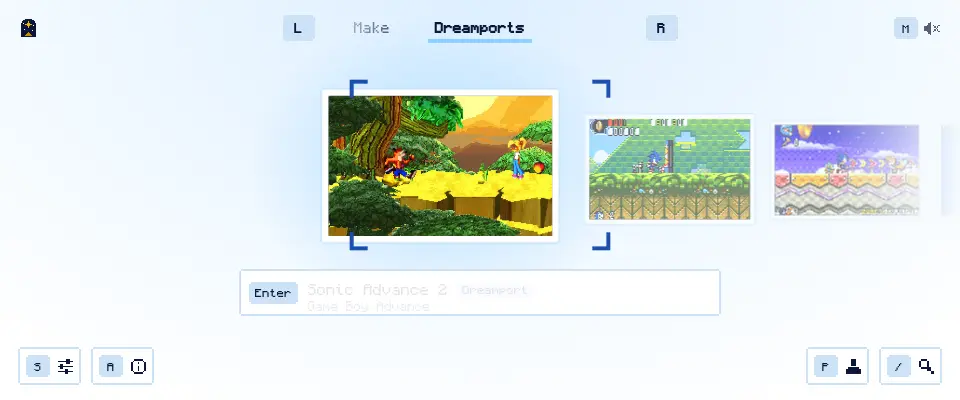
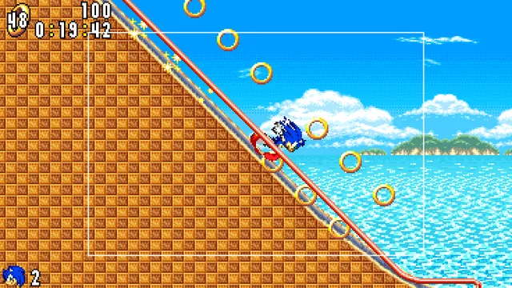
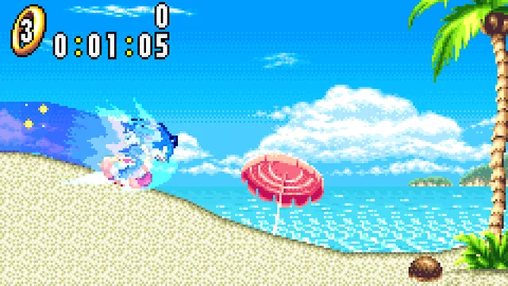
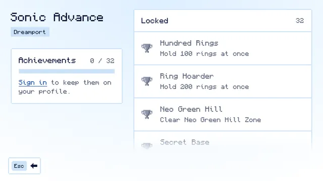
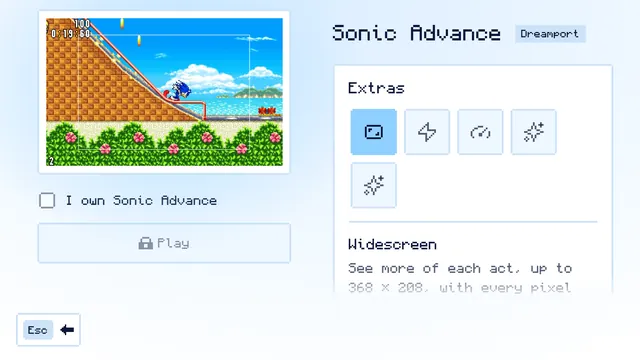
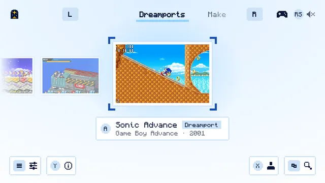
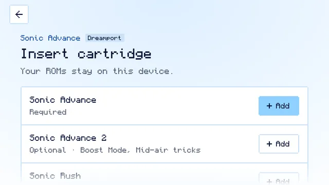

<div align="center">



<br>

### Every game ever made, in modern code, on every system.

Free · Bring your own copy of the game · Live at **[dreamports.net](https://dreamports.net)**

**[Make a Dreamport](#make-a-dreamport)**

</div>

<br>

Dreamports rebuilds games in modern programming languages, piece by piece, and plays them all from one launcher. A **Dreamport** is the port fans always dreamed of: the game you remember, with the extras you wished it had.

## Make a Dreamport

**No coding needed.** You bring the game, and your coding agent does the work.

You need your own copy of the game as a file, a free GitHub account, and a coding agent on your computer, such as Claude Code, Codex, Cursor, Gemini CLI or Antigravity CLI.

**1. Paste one sentence.** Open your agent in a new, empty folder and paste this, with your game's name in it:

```text
Set up https://dreamports.net/code and help me make Sonic Battle Dreamport.
```

Or, to start a game nobody has picked yet:

```text
Set up https://dreamports.net/code and help me start a Dreamport.
```

**2. Say where your copy of the game is.** Your agent gets everything ready, and asks before it installs anything.

**3. Wait for your pull request.** Your agent takes a free piece of the game, makes it, checks every frame against the original, and sends it to the Dreamports team or the game's lead. If a frame still differs, it says what and why.

**Next time,** open your agent in the `dreamports` folder and type `/dreamport <game>` (`$dreamport` in Codex).

**Good to know.** Your copy of the game stays on your computer. The only part of it that leaves is any function your agent reads, which goes to the company that runs its model. What your agent sends is public and in your name on GitHub, and pasting the sentence is your yes to that. If the game has no card on the site yet, a window opens where you can play and pick the moment it shows.

Every game being made is in the [Make tab](https://dreamports.net/make/), with its sentence ready to copy. Every Dreamport keeps the same rules, the [Dreamport standard](docs/STANDARD.md), and [CONTRIBUTING.md](CONTRIBUTING.md#make-a-dreamport) says what happens behind the scenes.

**For coding agents.** If someone asked you to set up https://dreamports.net/code, clone `https://github.com/NahuelGenchi/dreamports.git` into a folder called `dreamports` in the folder you were opened in, or use the Dreamports folder you're already in. Then read its [docs/MAKING.md](docs/MAKING.md) and follow Getting ready.

## What a finished Dreamport can bring

The game you remember, matching the original on every frame, plus:

- **Extras:** new stages, mechanics and other content, each one optional.
- **Online multiplayer:** play with friends anywhere.
- **Achievements:** earn them and keep them on your profile, on any device.
- **The launcher:** starts and works like every other game in it.
- **Xbox controller:** plays fully with your controller.
- **Better performance:** higher frame rates and smoother play.

### The best example so far: Sonic Advance Dreamport

It isn't finished yet, but it already has extras, achievements, the launcher and Xbox controller support. Online multiplayer and better performance are still to come. [Play it](https://dreamports.net/play/sonic-advance/) or [read more about it](games/sonic-advance/README.md).

<table>
  <tr>
    <td width="33%"></td>
    <td width="33%"></td>
    <td width="33%"></td>
  </tr>
  <tr>
    <td align="center"><sub><b>Extra:</b>&nbsp;widescreen&nbsp;view</sub></td>
    <td align="center"><sub><b>Extra:</b>&nbsp;Sonic&nbsp;Rush&nbsp;boost</sub></td>
    <td align="center"><sub><b>Achievements:</b>&nbsp;32&nbsp;to&nbsp;earn</sub></td>
  </tr>
  <tr>
    <td></td>
    <td></td>
    <td></td>
  </tr>
  <tr>
    <td align="center"><sub><b>The&nbsp;launcher:</b>&nbsp;its&nbsp;own&nbsp;page</sub></td>
    <td align="center"><sub><b>Xbox&nbsp;controller:</b>&nbsp;matching&nbsp;hints</sub></td>
    <td align="center"><sub><b>Your&nbsp;copy:</b>&nbsp;stays&nbsp;on&nbsp;your&nbsp;device</sub></td>
  </tr>
</table>

## The goal

Port every game that has ever existed to modern programming languages, and make the Dreamports launcher the place with the most games, in the most languages, on the most platforms.

| | Today | The plan |
| :--- | :--- | :--- |
| **Languages** | JavaScript | Games already in JavaScript ported again, to Rust and others |
| **Platforms** | The web, at dreamports.net | Apps for Android, Linux, Windows and macOS, and for older systems such as Nintendo 3DS, PSP and PS Vita, among many others |

Every platform should fully support the launcher's features and every game its hardware can run.

## Why it matters

**Games stop depending on old machines.** Today, an old game lives on as long as its console or an emulator does. Rebuilt in modern code, it can run wherever that code runs, and be fixed and improved for as long as people care.

**One launcher, everywhere.** The same launcher on a new phone or an old PSP, with every game that device can run.

**Anyone can help.** Porting a game used to take rare skills and years. Here anyone with a game and a coding agent can move it forward a piece at a time, and every piece is checked against the original, frame by frame.

**Every port makes the next one easier.** What people find on one game is written down for the next, and a game in readable JavaScript is a head start for Rust.

If this works, no game ever has to disappear again, and the gaming industry changes forever.

## Where it stands

See the [status of every Dreamport](docs/STATUS.md): how much of each game is ported and proven, who leads it and where to play it.

The work on Dreamports itself is tracked in [milestones](https://github.com/NahuelGenchi/dreamports/milestones).

## The golden rule: bring your own game

> [!IMPORTANT]
> **Dreamports never hosts game files.** No ROMs, no game data, and nothing taken from a game, ever. Every game needs **your own legal copy** of the original, which stays on your device.

## Help out

Press **Star** at the top of this page to follow along, or [report a problem](https://github.com/NahuelGenchi/dreamports/issues/new?template=work-item.yml). Developers can start with [CONTRIBUTING.md](CONTRIBUTING.md).

## Questions

<details>
<summary><b>Is it free?</b></summary>
<br>

Yes. The site and every Dreamport are free.

</details>

<details>
<summary><b>Where do I get the games?</b></summary>
<br>

From cartridges or discs you own. You copy the game to your computer with a reader or a dumping tool. Dreamports can't give you games or tell you where to download them.

</details>

<details>
<summary><b>Is it legal?</b></summary>
<br>

Dreamports never hosts game files, and every game asks for your own copy. The rules about copying games you own differ from country to country, so check the ones where you live. This isn't legal advice. Rights holders can reach the Dreamports team at hello@dreamports.net, as [docs/RIGHTS.md](docs/RIGHTS.md) explains.

</details>

<details>
<summary><b>Does the site track me?</b></summary>
<br>

No. Nothing follows you around the web, and the labels behind the menu are free pictures people asked for, not tracking ads. The site's [privacy section](https://dreamports.net/about/#privacy) has the details.

</details>

<details>
<summary><b>Can I put my art behind the menu?</b></summary>
<br>

Yes, for free. Labels are faint pictures of 240 by 60 pixels that drift behind the menu for 30 days, and a person checks each one first. The site's [Labels section](https://dreamports.net/about/#labels) says how to ask.

</details>

<details>
<summary><b>I found a security problem. Where do I report it?</b></summary>
<br>

Privately, please, through the **Security** tab. [SECURITY.md](SECURITY.md) explains how.

</details>

## License and credits

The code is free and open source under the [MIT License](LICENSE). These aren't covered by it:

- The pictures on this page and the recordings in [`public/media/`](public/media/) are captures of play, and show the games they come from.
- The small stars are the [Pixel Art Animated Star](https://soulofkiran.itch.io/pixel-art-animated-star) by Narik, recolored and used under Narik's terms. Thank you, Narik!

The site and the social preview are set in [Monocraft](https://github.com/IdreesInc/Monocraft) by Idrees Hassan, under the SIL Open Font License, in [`src/assets/fonts/OFL.txt`](src/assets/fonts/OFL.txt).

Game names and trademarks belong to their owners. Dreamports is an unofficial fan project, not affiliated with or endorsed by Sega, Nintendo, or any other publisher.
