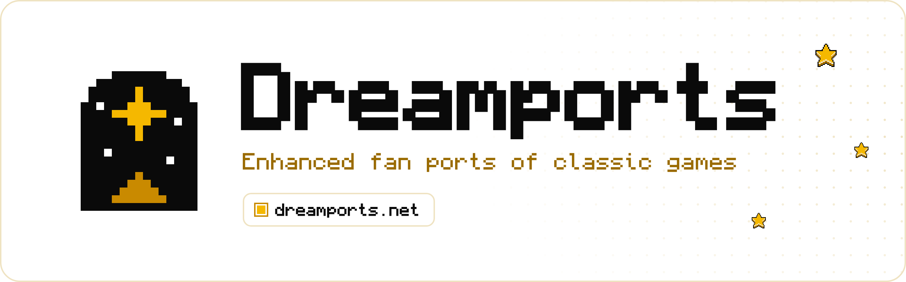

 

### Classic games, brought back by fans, with the extras fans dream of.

Free · Bring your own copy of the game · Live at **[dreamports.net](https://dreamports.net)**

 

[What is it?](#what-is-dreamports) &nbsp;·&nbsp; [What's inside](#whats-inside) &nbsp;·&nbsp; [Bring your own game](#the-golden-rule-bring-your-own-game) &nbsp;·&nbsp; [Progress](#progress) &nbsp;·&nbsp; [Help out](#help-out) &nbsp;·&nbsp; [Questions](#questions)

 

## What is Dreamports?

Dreamports is a website, at **[dreamports.net](https://dreamports.net)**, that gathers fan-made ports of classic games in one place. This repository holds its source code.

A **port** is a game brought somewhere new to play: your web browser, your computer, or a newer console. A **Dreamport** is the port fans always dreamed of: the game you remember, with the extras you wished it had. Widescreen, smoother motion, new ways to play: every extra is optional, and every Dreamport is made by a fan, for fans.

The site works like the menu of a game console. It's one screen with a row of games, and you move along it with the arrow keys, a game controller, a click or a swipe. The game you're on wakes up and plays a short recording of itself. Two tabs at the top switch between two rows:

<table>
<tr>
<td width="50%" valign="top">

🌙 **Dreamports** 
Enhanced ports, each named after the game it brings back, such as *Sonic Advance Dreamport*.

</td>
<td width="50%" valign="top">

✨ **Mash-ups** 
Great ports made by other fans, with a link to their own page and full credit to the people who made them, and fan games that aren't ports, such as *Kirby's Dead Land*.

</td>
</tr>
</table>

To find a game by its name, press the magnifier at the bottom right (or the / key) and type. The row then shows only the games whose names match.

**Profile**, at the bottom right (or the P key), keeps the achievements you earn in Sonic Advance Dreamport on any device. You sign in with a passkey: no password, no email. Your profile is private unless you make it public.

On a phone or tablet, you can add dreamports to your Home Screen: in Safari, tap Share, then **Add to Home Screen**; in Chrome on Android, open the ⋮ menu and choose **Add to Home screen**. It then opens like an app, without the browser's bars, and so do the games you play from it.

## What's inside

These are the projects on the site so far. Each one lives in its own repository.

| | Project | What it is | Try it |
| :---: | :--- | :--- | :--- |
| 🌙 | **[Sonic Advance Dreamport](https://github.com/NahuelGenchi/sonic-advance-dreamport)** | Sonic Advance (Game Boy Advance, 2001), rebuilt to play in your web browser. No emulator, nothing to install. Bring your own copy of the game. | [▶&nbsp;Play](https://dreamports.net/play/sonic-advance/) |
| ✨ | **[Kirby's Dead Land](https://github.com/NahuelGenchi/kirbys-dead-land)** | A mod that lets you play as Kirby inside Dead Cells, with his moves and copy abilities. For Linux; Windows is in testing. | [⬇&nbsp;Download](https://github.com/NahuelGenchi/kirbys-dead-land/releases/latest) |
| ✨ | **Your favorite fan port?** | Ports made by other fans are on their way to the mash-ups. Know a great one? | [💡&nbsp;Suggest](https://github.com/NahuelGenchi/dreamports/issues/new?template=work-item.yml) |

## The golden rule: bring your own game

> [!IMPORTANT]
> **Dreamports never hosts game files.** No ROMs, no game data, and nothing taken from a game, ever. Every project on the site asks you to use **your own legal copy** of the original game.

Not sure what that means? Here's how it works:

1. **You own the game,** on a cartridge or disc.
2. **You make your own copy** of it on your computer, called a *ROM* or a *game dump*. Each project explains which copy it needs.
3. **The port reads your copy on your device.** Your copy is never uploaded anywhere.

Before you play or download anything, the site asks you to confirm that you're using your own legal copy.

## Progress

The work is split into six steps, called *milestones*. The counts update by themselves as tasks are finished.

| Step | What it means | Progress |
| :--- | :--- | :--- |
| **[M0 — Project foundation](https://github.com/NahuelGenchi/dreamports/milestone/1)** | This repository: its look, its rules and how work is tracked |  |
| **[M1 — First version of the site](https://github.com/NahuelGenchi/dreamports/milestone/2)** | The website itself: the home page, every section, and the about page |  |
| **[M2 — Live on dreamports.net](https://github.com/NahuelGenchi/dreamports/milestone/3)** | The site online at its own address, updated automatically |  |
| **[M3 — Growth](https://github.com/NahuelGenchi/dreamports/milestone/4)** | More entries, plus search, filters and news. On hold for now |  |
| **[M4 — Sonic Advance Dreamport on dreamports.net](https://github.com/NahuelGenchi/dreamports/milestone/5)** | Sonic Advance Dreamport played right here on the site, with accounts, achievements and leaderboards |  |
| **[M5 — Game launcher](https://github.com/NahuelGenchi/dreamports/milestone/6)** | The site redesigned as a one-screen game launcher: a row of games to move through, filters, panels such as settings and about, and a launch animation, on phones and computers |  |

✅ The site is live at **[dreamports.net](https://dreamports.net)**.

## Help out

**No coding needed.** All you need is a free GitHub account.

<table>
<tr>
<td width="33%" valign="top">

💡 **Suggest a port** 
Know a great fan port that asks players to bring their own game? [Tell us about it](https://github.com/NahuelGenchi/dreamports/issues/new?template=work-item.yml).

</td>
<td width="33%" valign="top">

🐞 **Report a problem** 
A broken link, a typo, a page that looks wrong on your phone? [Let us know](https://github.com/NahuelGenchi/dreamports/issues/new?template=work-item.yml).

</td>
<td width="33%" valign="top">

⭐ **Follow along** 
Press **Star** at the top of this page to keep Dreamports on your radar.

</td>
</tr>
</table>

**Developers:** every change follows the same trail, 📝 issue → 🌿 branch → 🎯 milestone → 🔀 pull request, so anything on the site can be traced back to why it was made. Start with [CONTRIBUTING.md](CONTRIBUTING.md); the full rules are in [docs/TRACKING.md](docs/TRACKING.md). The site is built with [Astro](https://astro.build/) and hosted on [Cloudflare](https://www.cloudflare.com/); every change merged here goes live by itself. Adding a game takes one Markdown file: CONTRIBUTING.md shows how.

## Questions

<b>Is Dreamports free?</b>

 

Yes. The site and every Dreamport are free.

<b>Where do I get the games?</b>

 

From cartridges or discs you own. You copy the game to your computer with a reader or a dumping tool, and each project's page explains which copy it needs. Dreamports can't give you games or tell you where to download them.

<b>Is this legal?</b>

 

Dreamports never hosts game files, and it only lists projects that ask you to use your own copy. Game names and trademarks belong to their owners. Dreamports is an unofficial fan project, not affiliated with or endorsed by Sega, Nintendo, or any other publisher.

The rules about copying games you own differ from country to country, so check the ones where you live. This isn't legal advice.

<b>Why "Dream"?</b>

 

A Dreamport is the port fans always dreamed of: the game you remember, with the extras you wished it had.

<b>Can my port be listed?</b>

 

Yes, if it asks players to bring their own legal copy and doesn't include game files. [Suggest it here](https://github.com/NahuelGenchi/dreamports/issues/new?template=work-item.yml), with a link to its page and who made it.

<b>Where is the website?</b>

 

At **[dreamports.net](https://dreamports.net)**. It updates by itself whenever a change is accepted here.

<b>Does the site track me?</b>

 

No. There are no ads, and nothing follows you around the web. The site keeps a few small notes in your own browser, such as whether you switched on the menu's sounds and whether you picked light or dark. They never leave your device, and **forget my choices** in the site's settings clears them. To see which pages people read, the site counts visits with [Cloudflare Web Analytics](https://www.cloudflare.com/web-analytics/), which stores nothing in your browser and doesn't keep your IP address.

A **profile** is optional. It keeps your achievements from Sonic Advance Dreamport on any device, under a name you pick. You sign in with a passkey, so there's no password and no email address, and one cookie keeps you signed in. Your profile stays private unless you make it public, and you can download it or delete it at any time. The site's [privacy section](https://dreamports.net/about/#privacy) has the details.

<b>I found a security problem. Where do I report it?</b>

 

Privately, please, through the **Security** tab. [SECURITY.md](SECURITY.md) explains how.

## License and credits

The code is free and open source under the [MIT License](LICENSE).

The banner and the social preview are original pixel art made for Dreamports, set in [Monocraft](https://github.com/IdreesInc/Monocraft) by Idrees Hassan, under the SIL Open Font License. Their source, [`.github/readme/banner.html`](.github/readme/banner.html), can redraw them.

The website is set in Monocraft too. It carries a smaller copy with only the letters it uses; the license is in [`src/assets/fonts/OFL.txt`](src/assets/fonts/OFL.txt) and [`public/licenses/`](public/licenses/).

The small stars are the [Pixel Art Animated Star](https://soulofkiran.itch.io/pixel-art-animated-star) by Narik, recolored to match. They're used under Narik's terms, which allow personal and commercial use and edits, so [`.github/readme/star.png`](.github/readme/star.png) and the website's copy, [`public/images/star.png`](public/images/star.png), aren't covered by the MIT License. Thank you, Narik!

The recordings of the games, in [`public/media/`](public/media/), are the owner's own captures of their own projects. They show the games those projects work with, so they aren't covered by the MIT License either. The menu's sounds are made for Dreamports: your browser creates them as it plays them, so there are no sound files.

Game names and trademarks belong to their owners. Dreamports is not affiliated with or endorsed by Sega, Nintendo, or any other publisher.

 

Made by a fan, for fans · <a href="https://github.com/NahuelGenchi">Nahuel Genchi</a>

