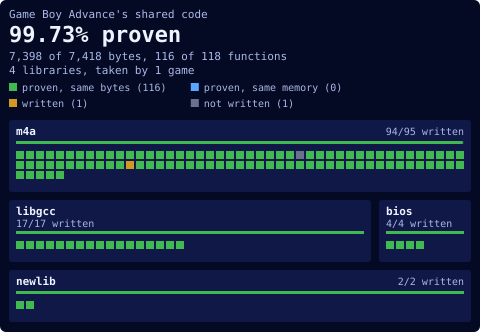
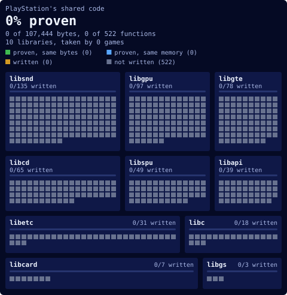

# Status of every Dreamport

[Back to README](../README.md) · [Make a Dreamport](../README.md#make-a-dreamport) · [How progress is measured](STANDARD.md#how-progress-is-measured)

Each game shows two numbers. **Code ported** is how much of the original game's code has been written again, function by function, and it opens the game's issue, where you can follow all of its porting. **Gameplay proven** is how much of the game has been played next to the original, with every frame matching, and it opens the game's progress map, with every piece of its code and every part of the game, green once it's done.

Both numbers are of the game's version in C, the language every Dreamport is written in, and the games go from the most code ported to the least. Every game needs your own copy of the original. The proof tools write this table from each Dreamport's entry, so nobody types its numbers. It can be up to three hours behind the site.

<!-- The proof tools write this table from each Dreamport's entry: npm run dp -- readme. -->

| Game | Console | Code ported | Gameplay proven | Lead | Try it |
| :--- | :--- | :--- | :--- | :--- | :--- |
| [Ghosts'n Goblins](../games/ghosts-n-goblins/c/) | NES | [48.08%](https://github.com/NahuelGenchi/dreamports/issues/977) | [42.86%, 6 of 14 parts](../.github/readme/progress/ghosts-n-goblins-c.svg) | [klaudito70](https://github.com/klaudito70) | [▶&nbsp;Play](https://dreamports.net/play/ghosts-n-goblins/) |
| [Sonic Battle](../games/sonic-battle/c/) | Game Boy Advance | [31.27%](https://github.com/NahuelGenchi/dreamports/issues/123) | [9.12%, 7 of 20 parts](../.github/readme/progress/sonic-battle-c.svg) | [NahuelGenchi](https://github.com/NahuelGenchi) | [▶&nbsp;Play](https://dreamports.net/play/sonic-battle/) |
| [Sonic Advance](../games/sonic-advance/c/) | Game Boy Advance | [6.01%](https://github.com/NahuelGenchi/dreamports/issues/146) | [4.53%, 3 of 40 parts](../.github/readme/progress/sonic-advance-c.svg) | [NahuelGenchi](https://github.com/NahuelGenchi) | [▶&nbsp;Play](https://dreamports.net/play/sonic-advance/) |
| [Mega Man](../games/mega-man/c/) | NES | [2.32%](https://github.com/NahuelGenchi/dreamports/issues/671) | [7.69%, 1 of 13 parts](../.github/readme/progress/mega-man-c.svg) | [NahuelGenchi](https://github.com/NahuelGenchi) | [▶&nbsp;Play](https://dreamports.net/play/mega-man/) |
| [Sonic Advance 3](../games/sonic-advance-3/c/) | Game Boy Advance | [0.46%](https://github.com/NahuelGenchi/dreamports/issues/295) | [0.56%, 1 of 67 parts](../.github/readme/progress/sonic-advance-3-c.svg) | [NahuelGenchi](https://github.com/NahuelGenchi) | [▶&nbsp;Play](https://dreamports.net/play/sonic-advance-3/) |
| [The Sims](../games/the-sims/c/) | PlayStation 2 | [0%](https://github.com/NahuelGenchi/dreamports/issues/1817) | [0%, 0 of 13 parts](../.github/readme/progress/the-sims-c.svg) | [SofiaGenchi](https://github.com/SofiaGenchi) | [▶&nbsp;Play](https://dreamports.net/play/the-sims/) |
| [Crash Bandicoot Purple: Ripto's Rampage](../games/crash-bandicoot-purple/c/) | Game Boy Advance | [0%](https://github.com/NahuelGenchi/dreamports/issues/296) | [0%, 0 of 24 parts](../.github/readme/progress/crash-bandicoot-purple-c.svg) | [NahuelGenchi](https://github.com/NahuelGenchi) | [▶&nbsp;Play](https://dreamports.net/play/crash-bandicoot-purple/) |
| [Sonic Advance 2](../games/sonic-advance-2/c/) | Game Boy Advance | [0%](https://github.com/NahuelGenchi/dreamports/issues/396) | [0%, 0 of 44 parts](../.github/readme/progress/sonic-advance-2-c.svg) | [NahuelGenchi](https://github.com/NahuelGenchi) | [▶&nbsp;Play](https://dreamports.net/play/sonic-advance-2/) |

<!-- End of the table of Dreamports. -->

## Shared code

Some code is in many games of a console without any of them having written it: the console maker's libraries, sound drivers and the helpers its compiler adds. It's written once in the kit, and each Dreamport that has it takes it from there and proves it on its own copy ([Shared libraries](../tools/README.md#shared-libraries)). Each console's map shows its libraries as blocks and their functions as cells: green once proven by the same bytes, blue once proven by the same memory, amber while written and not proven yet, and grey while nobody has written it.

<!-- The proof tools draw these maps from the kit's shared libraries: npm run dp -- readme. -->

<!-- End of the maps of shared code. -->
